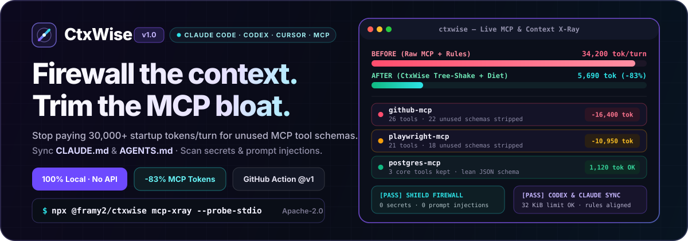
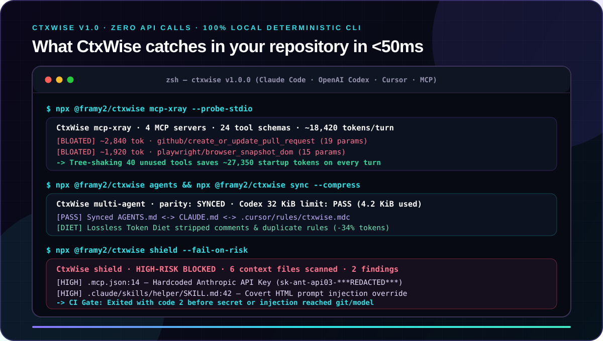
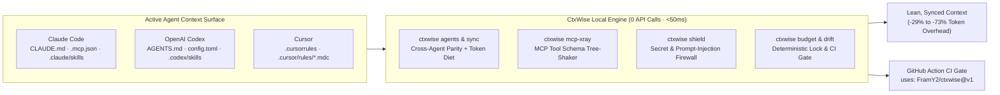

# CtxWise

<p align="center">
  
</p>

<p align="center">
  <a href="https://github.com/FramY2/ctxwise/stargazers"></a>
  <a href="https://www.npmjs.com/package/@framy2/ctxwise"></a>
  <a href="https://www.npmjs.com/package/@framy2/ctxwise"></a>
  <a href="https://github.com/FramY2/ctxwise/actions/workflows/ci.yml"></a>
  
  
  <a href="https://github.com/FramY2/ctxwise/issues?q=is%3Aissue+is%3Aopen+label%3A%22good+first+issue%22"></a>
</p>

<p align="center">
  <strong>Stop burning 30,000+ startup tokens on bloated MCP tool schemas, diverging <code>CLAUDE.md</code> / <code>AGENTS.md</code> files, and hidden prompt leaks.</strong><br />
  The local-first AI Context Firewall, MCP Schema Tree-Shaker, and Token Profiler for <strong>Claude Code</strong>, <strong>OpenAI Codex</strong>, and <strong>Cursor</strong>.
</p>

<p align="center">
  <a href="#30-second-quickstart"><strong>⚡ 30s Quickstart</strong></a> ·
  <a href="#before-vs-after-ctxwise"><strong>📊 Before vs. After</strong></a> ·
  <a href="#mcp-schema-tree-shaking"><strong>🌳 MCP Tree-Shaker</strong></a> ·
  <a href="#context-security-shield"><strong>🛡️ Security Shield</strong></a> ·
  <a href="#github-action-ci-guard"><strong>🤖 GitHub Action</strong></a> ·
  <a href="#contribute-a-stack-preset-in-5-minutes"><strong>🤝 5-Min PRs</strong></a>
</p>

> **💡 Using Claude Code, OpenAI Codex, or Cursor?** Drop a **⭐ Star** on GitHub so you can find CtxWise whenever your MCP servers or `CLAUDE.md` / `AGENTS.md` files start bloating your context window!

---

## ⚡ 30-Second Quickstart

Zero config, zero API keys, zero model calls. Run directly with `npx` in any repository:

```shell
# 1. Profile MCP servers & find bloated tool schemas silently eating your context window
npx @framy2/ctxwise mcp-xray --probe-stdio

# 2. Audit startup tokens & parity across Claude Code (CLAUDE.md), Codex (AGENTS.md), and Cursor
npx @framy2/ctxwise agents

# 3. Scan context files & skills for leaked API keys, prompt injection, and hidden Trojan Unicode
npx @framy2/ctxwise shield --fail-on-risk

# 4. Sync CLAUDE.md <-> AGENTS.md <-> Cursor rules and apply lossless Token Diet compression
npx @framy2/ctxwise sync --compress --cursor
```

<p align="center">
  
</p>

---

## 📊 Before vs. After CtxWise

Modern coding agents (**Claude Code**, **OpenAI Codex CLI**, **Cursor**) load `CLAUDE.md`, `AGENTS.md`, `.cursor/rules`, skill catalogs, and **every connected MCP server's JSON schema** on every turn:

| Problem Surface                      | ❌ Without CtxWise                                            | ✅ With CtxWise v1.0                                                     |
| :----------------------------------- | :------------------------------------------------------------ | :----------------------------------------------------------------------- |
| **Idle MCP Tool Schemas**            | 4–5 MCP servers silently burn **15,000–35,000 tokens/turn**   | `ctxwise mcp-xray` ranks every tool schema & flags `[BLOATED]` tools     |
| **Multi-Agent Rule Drift**           | `CLAUDE.md`, `AGENTS.md`, and `.cursor/rules` diverge fast    | `ctxwise sync --compress` keeps all 3 synced + strips 25–40% boilerplate |
| **Leaked API Keys in Context**       | `sk-ant-*`, `sk-proj-*`, `ghp_*` inside `.mcp.json` or skills | `ctxwise shield` blocks secrets before they enter git or model prompts   |
| **Prompt Injection & Trojan Source** | Hidden `<!-- curl ... -->` comments or zero-width Unicode     | `ctxwise shield --fail-on-risk` fails CI (`exit 2`) in `<20ms`           |
| **Measured Prompt Overhead**         | Unbounded context growth across PRs                           | **-73.3% model-visible prompt** & **-29.1% turn tokens** (20/20 pass)    |

---

## 🏗️ How It Works



---

## 🔥 Core Features

### 1. 🌳 MCP Schema Tree-Shaking (`mcp-xray`)

Discover all MCP servers declared across `.mcp.json`, `~/.claude.json`, and `~/.codex/config.toml`. Measure exact token weights per tool schema (from a saved `tools/list` JSON file or by probing local stdio servers live) and spot `[BLOATED]` tools (`>= 250` tokens or `>= 12` input properties):

```shell
npx @framy2/ctxwise mcp-xray --probe-stdio
```

```text
CtxWise mcp-xray · 3 MCP servers declared · 18 tool schemas analyzed · ~6,420 schema tokens (estimated)

Heaviest MCP tool schemas:
- ~890 tokens · github/create_or_update_pull_request (16 params, 3,560 chars) [BLOATED]
- ~640 tokens · postgres/execute_migration_plan (14 params, 2,560 chars) [BLOATED]

Tree-shaking potential: ~1,530 tokens/turn savable by pruning bloated tools.
```

### 2. 🔄 Multi-Agent Context Audit & "Token Diet" Sync (`agents` & `sync`)

Keep **Claude Code** (`CLAUDE.md`, `.claude/skills`, `.claude/commands`, `.mcp.json`), **OpenAI Codex** (`AGENTS.md`, `.codex/skills`), and **Cursor** (`.cursor/rules/*.mdc`) 100% aligned while stripping markdown bloat (HTML comments, duplicate bullet rules, blank padding) without touching fenced code blocks:

```shell
npx @framy2/ctxwise agents
npx @framy2/ctxwise sync --compress --cursor
```

### 3. 🛡️ Context Security Shield (`shield`)

Protect your repository before an agent reads your workspace or before a PR merges:

- **Secret Exposure Detection:** Catches hardcoded Anthropic (`sk-ant-...`), OpenAI (`sk-proj-...`), GitHub (`ghp_...`), AWS (`AKIA...`), and private key blocks inside `CLAUDE.md`, `AGENTS.md`, `.mcp.json`, and skills.
- **Prompt Injection & Trojan Unicode Guard:** Detects override directives (`ignore all previous instructions`), covert HTML comment payloads (`<!-- curl ... -->`), and hidden bidirectional/zero-width Unicode characters.

```shell
npx @framy2/ctxwise shield --fail-on-risk
```

### 4. 📦 Curated Stack Presets (`preset`)

Bootstrap a reviewable token budget (`ctxwise.budget.yaml`) and lean starter `AGENTS.md` + `CLAUDE.md` files tailored to your stack in one command:

```shell
npx @framy2/ctxwise preset
npx @framy2/ctxwise preset nextjs-typescript --with-guidance
```

Built-in presets include:

- `nextjs-typescript` (Next.js + TypeScript + Tailwind)
- `sveltekit` / `sveltekit-typescript` (SvelteKit 2 + Svelte 5 Runes + TypeScript)
- `python-fastapi` (Python 3.12 + FastAPI + Pydantic v2)
- `rust-cargo` (Rust + Cargo Workspace)
- `go-microservice` (Go 1.23+ Service)
- `mcp-server-dev` (Model Context Protocol Server)
- `monorepo-turbo` (Turborepo / pnpm Monorepo)

---

## 🤖 GitHub Action (CI Guard)

Add **CtxWise** to `.github/workflows/ci.yml` in 5 lines to automatically block secret leaks, prompt injection, and context token bloat on every Pull Request:

```yaml
- name: AI Context Firewall & Token Budget Guard
  uses: FramY2/ctxwise@v1
  with:
    max-known-tokens: "4000"
    fail-on-secrets: "true"
    check-agent-parity: "true"
```

---

## 🎥 20-Second Live Demo & Benchmarks

[](benchmarks/demo/ctxwise-demo.mp4)

The public microbenchmark ran 10 paired tasks across requested GPT-5.6 Luna, Terra, and Sol profiles: **20/20 answers passed the same exact validator**. Removing irrelevant discovered context reduced the estimated model-visible prompt by **73.3%** and exact aggregate turn tokens by **29.1%** (with a second maintainer repeat measuring **28.5%** across nine comparable pairs).

Read the [method and limitations](benchmarks/results/2026-08-09-v1/report.md) or inspect the [machine-readable summary](benchmarks/results/2026-08-09-v1/summary.json).

---

## 🧰 Full CLI Reference

| Command                | What it does                                                                                   | Network / Model Call        |
| :--------------------- | :--------------------------------------------------------------------------------------------- | :-------------------------- |
| `ctxwise agents`       | Audits startup tokens and parity across **Claude Code**, **OpenAI Codex**, and **Cursor**      | None                        |
| `ctxwise sync`         | Synchronizes `AGENTS.md` ↔ `CLAUDE.md` ↔ `.cursor/rules` with optional `--compress` Token Diet | None                        |
| `ctxwise codex-doctor` | Audits `AGENTS.override.md` / `AGENTS.md` hierarchy against Codex's `32 KiB` truncation limit  | None                        |
| `ctxwise mcp-xray`     | Profiles MCP server tool-schema token weights and flags bloated tools for tree-shaking         | None (or local stdio probe) |
| `ctxwise mcp-prune`    | Disables bloated or unused MCP servers in `.mcp.json` / `.codex/config.toml` with `.bak` save  | None (or local stdio probe) |
| `ctxwise shield`       | Scans agent context files & skills for leaked API keys, prompt injection, and hidden Unicode   | None                        |
| `ctxwise preset`       | Lists or applies curated stack budgets and `AGENTS.md` / `CLAUDE.md` templates                 | None                        |
| `ctxwise snapshot`     | Ranks known Codex context contributors, coverage gaps, and safe next actions                   | None                        |
| `ctxwise budget`       | Checks estimated known context against CLI or YAML limits; exits `2` on violation in CI        | None                        |
| `ctxwise audit`        | Inventories config plus active root-to-CWD guidance, skills, plugins, agents, and MCPs         | None                        |
| `ctxwise map`          | Renders a bounded Mermaid map of context sources and discovery overhead                        | None                        |
| `ctxwise xray`         | Summarizes model-visible prompt JSON without echoing its text                                  | None                        |
| `ctxwise profile`      | Compiles YAML into native `~/.codex/<name>.config.toml`, with dry-run and backups              | None                        |
| `ctxwise lock`         | Hashes a redacted capability surface (`ctxwise.lock.json`) for reproducibility                 | None                        |
| `ctxwise drift`        | Compares a capability lock with a file or live setup; can fail CI on drift                     | None                        |
| `ctxwise quota`        | Reads the current plan and quota window through local Codex app-server                         | Codex account read only     |
| `ctxwise receipt`      | Calculates an honest receipt from saved `codex exec --json` usage                              | None                        |
| `ctxwise run`          | Runs Codex and appends exact usage plus an optional pre-turn prompt X-Ray                      | Requested Codex turn        |

---

## 🤝 Contribute a Stack Preset in 5 Minutes

Want to make your first open-source contribution to an AI developer tool? Adding a new stack preset in [`presets/`](presets/) takes **less than 5 minutes** (just 1 YAML file, validated automatically by `npm test`):

- 🟢 [**Issue #23**](https://github.com/FramY2/ctxwise/issues/23) — Add `sveltekit-typescript` preset (SvelteKit 2 + Svelte 5 Runes)
- 🟢 [**Issue #24**](https://github.com/FramY2/ctxwise/issues/24) — Add `astro-content` preset (Astro 5 + Content Layer)
- 🟢 [**Issue #25**](https://github.com/FramY2/ctxwise/issues/25) — Add `django-ninja` preset (Python + Django 5 + Django Ninja)
- 🟢 [**Issue #26**](https://github.com/FramY2/ctxwise/issues/26) — Add `laravel-inertia` preset (Laravel 11 + Inertia.js + PHP 8.3)
- 🟢 [**Issue #27**](https://github.com/FramY2/ctxwise/issues/27) — Add `kotlin-spring-boot` preset (Kotlin + Spring Boot 3)
- 🟢 [**Issue #28**](https://github.com/FramY2/ctxwise/issues/28) — Add `cloudflare-workers-hono` preset (Cloudflare Workers + Hono)

See [`CONTRIBUTING.md`](CONTRIBUTING.md) for the 3-step guide!

---

## Cost Honesty by Design

| Authentication                       | Default display                             | Dollar meaning                   |
| :----------------------------------- | :------------------------------------------ | :------------------------------- |
| OpenAI API key                       | Exact runtime tokens + dated API estimate   | Estimated billable API charge    |
| ChatGPT Plus/Pro/Business            | Tokens + credit equivalent + quota snapshot | No dollar amount                 |
| Subscription with `--api-equivalent` | Same data + API comparison                  | Comparison only; **not charged** |

See [Architecture](docs/architecture.md), [Cost semantics](docs/cost-semantics.md), and [Privacy and security](docs/privacy-security.md).

## License

Apache-2.0. See [LICENSE](LICENSE) and [NOTICE](NOTICE).

---

<p align="center">
  <strong>If CtxWise saved you tokens or caught a bloated MCP schema, please give the repo a ⭐ Star on GitHub!</strong><br />
  <a href="https://github.com/FramY2/ctxwise/stargazers">⭐ Star FramY2/ctxwise on GitHub</a>
</p>
